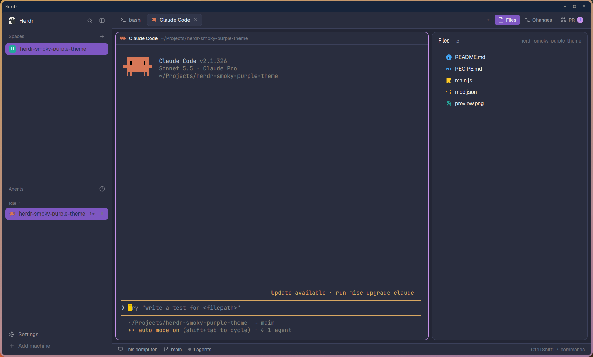

# Smoky Purple theme for Herdr



Smoky Purple is a dark colour theme for [Herdr](https://herdr.dev), the desktop app for terminals and coding agents. It is based on Palenight and uses a purple colour for selected items.

It comes as a mod. A mod is a small add-on that adds a panel or dialog to Herdr. This one adds a dialog with one button, **Install and apply**. Nothing changes in your setup until you press it.

## What you need

- Herdr installed and running.
- Git, to download this repository. You can also download it as a ZIP file with the **Code** button on this page.

## Install

1. Download the repository:

   ```sh
   git clone https://github.com/bkbatchelor/herdr-smoky-purple-theme.git
   ```

2. Create the mod folder and copy two files into it:

   ```sh
   mkdir -p ~/.config/herdr-app/mods/smoky-purple-theme
   cp herdr-smoky-purple-theme/main.js herdr-smoky-purple-theme/mod.json ~/.config/herdr-app/mods/smoky-purple-theme/
   ```

3. Check that Herdr accepts the mod:

   ```sh
   herdr-app check ~/.config/herdr-app/mods/smoky-purple-theme
   ```

   You should see `check passed`.

If the check fails, the message names the file and line. The most common cause is a missing file. Run the `cp` command again and look for errors. If `herdr-app` is not found, restart your terminal so it picks up your updated `PATH`, which is the list of folders your terminal searches for commands.

## Use the theme

1. Open the dialog:

   ```sh
   herdr-app do mod.open '{"name":"smoky-purple-theme"}'
   ```

   The dialog shows ten colour swatches and a status line.

2. Click **Install and apply**.

   The window switches to Smoky Purple. The status line changes to "Installed. Applying switches to it."

If the status line turns red, the dialog could not write the theme file or switch themes. The message says why. One cause is a theme file that changed while the dialog was working. Close the dialog, open it again, and click the button again.

If the dialog does not open, run `herdr-app status`. It lists errors from every mod.

## Status messages

The dialog reads your theme file when it opens, and it never writes anything until you click the button.

| Status line | What it means |
|---|---|
| Checking… | The dialog is reading your theme file. |
| Not installed yet. Applying writes themes/smoky-purple.json. | The theme file does not exist. The button creates it. |
| Installed. Applying switches to it. | The file exists and matches this mod. The button switches to it. |
| Installed, but different from this mod. Applying replaces it. | The file exists but has other colours. The button overwrites it. |

## What it changes

Pressing **Install and apply** does two things:

- It writes `~/.config/herdr-app/themes/smoky-purple.json`.
- It sets the theme of the layout you are using to `smoky-purple`. A layout is a saved window design in Herdr.

It does not change your fonts, your keys, or `settings.json`. It cannot overwrite a theme called `palenight`, because it uses its own name.

## Colours

| Part | Colour |
|---|---|
| Background | `#292d3e` |
| Text | `#bfc7d5` |
| Selected text background | `#414764` |
| Cursor | `#ffcc00` |
| Accent | `#c792ea` |
| Selected row | `#7e57c2` |
| Panel background | `#31364a` |
| Window background | `#232635` |
| Borders | `#3b405a` |

The 16 terminal colours are in `main.js`.

## Change the colours

1. Open `~/.config/herdr-app/mods/smoky-purple-theme/main.js` in a text editor.
2. Edit the colour values in the `THEME` block near the top. Use six-digit values such as `#7e57c2`. Keep the `ansi` list at exactly 16 colours, or Herdr will not load the theme.
3. Save the file. Herdr reloads the mod by itself.
4. Open the dialog and click **Install and apply**. The status line first says the file is different. The button replaces it.

## Remove the theme

1. In Herdr, choose another theme in the theme picker.
2. Delete the theme file and the mod folder:

   ```sh
   rm ~/.config/herdr-app/themes/smoky-purple.json
   rm -r ~/.config/herdr-app/mods/smoky-purple-theme
   ```

If your window is still purple after this, the layout still points at the theme. Choose another theme in the picker and it updates.

## Files in this repository

| File | What it is |
|---|---|
| `main.js` | The mod. It holds the theme and the dialog. |
| `mod.json` | Tells Herdr the mod has no panel of its own and sets the dialog size. |
| `RECIPE.md` | A full description of the mod, written so another person or agent can rebuild it. |
| `preview.png` | The screenshot at the top of this page. |

## Safety

This mod writes one file outside its own folder, `themes/smoky-purple.json`, and changes your theme when you press the button. It makes no network requests and runs no programs.
