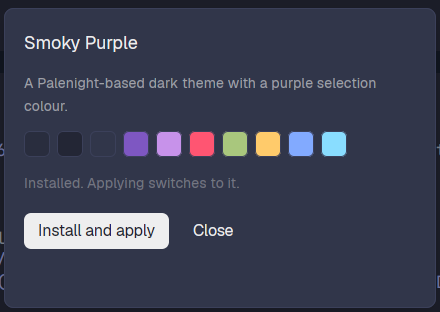

# Smoky Purple theme

A one-folder mod that carries the Smoky Purple colour theme: a dark Palenight-based
look with a purple selection colour. Open it, press **Install and apply**, and Herdr
switches to the theme. Nothing changes until the person presses the button.

## What you see

A small dialog, 360 × 250 px, opened with `mod.open smoky-purple-theme`:

1. Title "Smoky Purple" (15 px, semibold).
2. One line of description in muted text (12 px): "A Palenight-based dark theme with a
   purple selection colour."
3. A row of ten 22 px rounded swatches, in this order: `#292d3e`, `#232635`, `#31364a`,
   `#7e57c2`, `#c792ea`, `#ff5572`, `#a9c77d`, `#ffcb6b`, `#82aaff`, `#89ddff`.
4. One status line (12 px, dim; `blocked` colour on error).
5. Two buttons: **Install and apply** (a solid primary button) and **Close** (raised).

## How it behaves

- **Opening** only reads `themes/smoky-purple.json`. It never writes.
- Status line text:
  - checking: "Checking…"
  - file absent: "Not installed yet. Applying writes themes/smoky-purple.json."
  - file differs from the embedded theme: "Installed, but different from this mod.
    Applying replaces it."
  - file identical: "Installed. Applying switches to it."
  - read or write failed: the error message, in the `blocked` colour.
- **Install and apply** writes the file if it is missing or different, sets status to
  installed, then runs `app.theme {name: "smoky-purple"}`. While it works the button reads
  "Applying…" and ignores further clicks.
- **Close** closes the dialog. Esc also closes it.
- Hover: the primary button fades slightly; Close takes the `hover` colour.

## Built from

- `mod.json`: `{ "place": "none", "title": "Smoky Purple theme", "overlay": { "width": 360, "height": 250 } }`.
- `main.js`: a default-exported `View`.
  - The whole theme is a JS object, `THEME`, serialised once with
    `JSON.stringify(THEME, null, 2) + "\n"` as `TEXT`. This is the exact file content.
  - `init(_props, cx)`: returns early when `checking()`, else reads the theme file.
  - Path: `${appHome()}/themes/smoky-purple.json`.
  - Read with `readTextFile` (null means absent). Write with
    `writeTextFile(path, TEXT, have)`, where `have` is the text just read, or null to create.
  - Switch with `run("app.theme", { name: "smoky-purple" })`.
  - Close with `closeOverlay(props().overlay)`.
- Imports: `View`, `div` from `gpui-kit`; `v_flex`, `h_flex` from `gpui-base`; `theme`, `run`,
  `appHome`, `readTextFile`, `writeTextFile`, `closeOverlay`, `props`, `checking` from `herdr`.
- The theme object, all `#rrggbb`:
  - `background #292d3e`, `foreground #bfc7d5`, `selection #414764`, `cursor #ffcc00`.
  - `ansi` (16): `#676e95 #ff5572 #a9c77d #ffcb6b #82aaff #c792ea #89ddff #ffffff`, then the same
    eight again with `#c3e88d` in place of the third.
  - `colors`: `accent #c792ea`, `chrome #292d3e`, `surface #292d3e`, `popover #31364a`,
    `canvas #232635`, `raised #31364a`, `hover #34394f`, `selected #7e57c2`, `border #3b405a`.

## Watch out

- **It writes a file outside its own folder** (`themes/smoky-purple.json`) and changes the
  person's theme when the button is pressed. Say so before adding it.
- The installed theme is named `smoky-purple`, not `palenight`, so it can never overwrite
  someone's own Palenight file. Keep that name.
- Do not write the file or switch theme at start-up. `init()` runs during
  `herdr-app check`, and a theme change nobody asked for would be a surprise.
- `writeTextFile` rejects when the file changed since it was read; surface that as the error
  status rather than retrying.
- Keep the `ansi` array at exactly 16 entries or the theme will not load.
- The mod does not touch fonts, layouts or `settings.json`. Colours only.
- `app.theme` changes the shown layout's root `theme`; a layout that sets its own `colors`
  keeps those overrides on top.

## Done when

- `herdr-app check mods/smoky-purple-theme` passes.
- `herdr-app do mod.open '{"name":"smoky-purple-theme"}'` shows the dialog, and the status
  line reads "Not installed yet…" when `themes/smoky-purple.json` is absent.
- Pressing **Install and apply** creates `themes/smoky-purple.json` with exactly the
  `THEME` contents, and the window switches to the theme.
- Reopening the dialog reads "Installed. Applying switches to it."
- Editing the file by hand and reopening reads "Installed, but different from this mod…".
- `herdr-app status` reports no errors.
